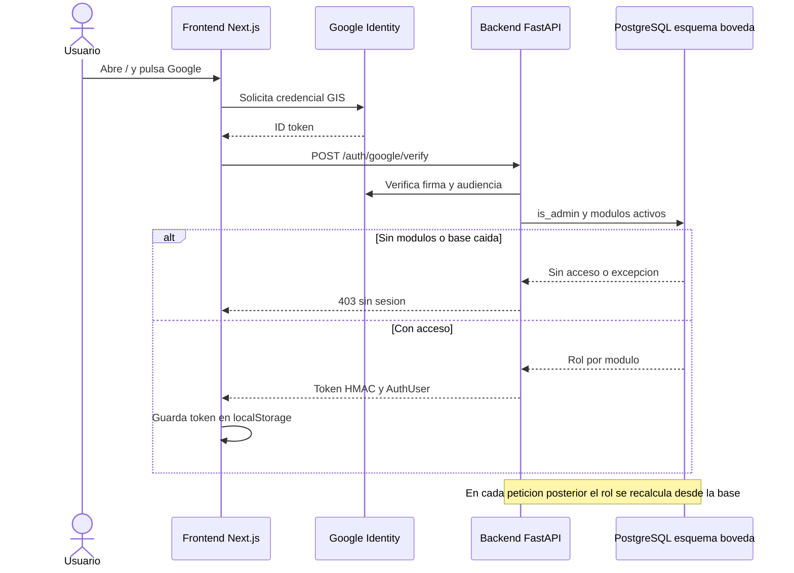
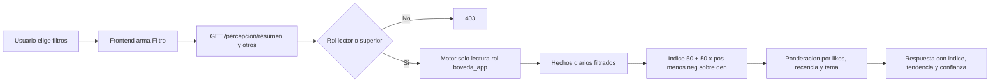
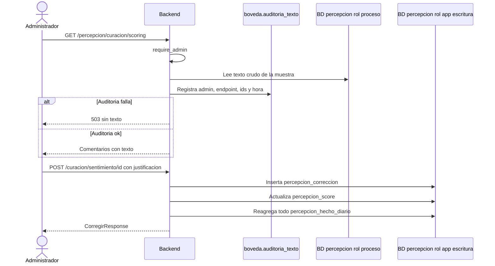
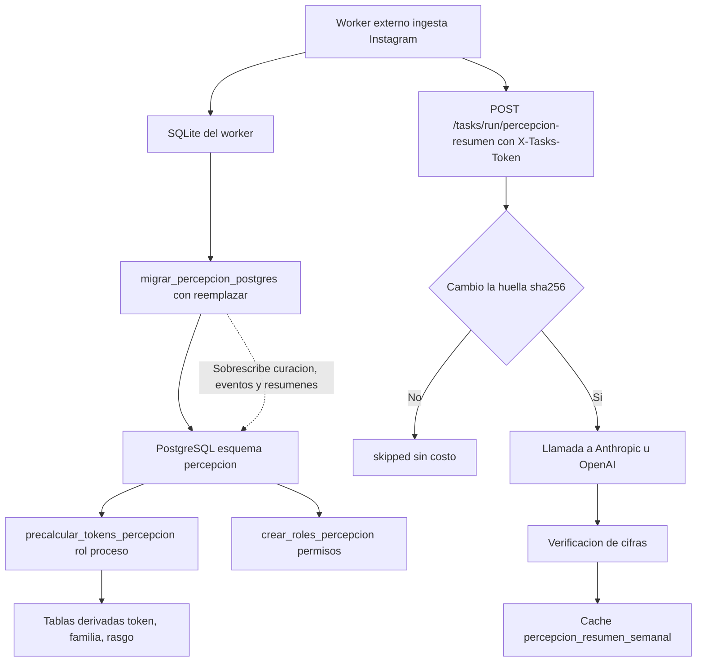

# 01 · Ficha funcional — Bóveda DAI

> Diagnóstico del 2026-10-22 sobre el commit `6879a9e`. Estados: **Confirmado**, **Confirmado por el responsable**, **Inferido**, **Propuesto**, **No verificado** (ver [README.md](README.md)). Rutas relativas a la raíz del repositorio.

## 1. Identificación de la aplicación

| Campo | Valor | Estado y evidencia |
|---|---|---|
| Nombre actual | **Bóveda DAI** (aplicación). Su único módulo se llama **Termómetro Institucional**, con id interno `percepcion` | Confirmado: `README.md:1`, `frontend/src/app/layout.tsx` (título "Bóveda DAI"), `backend/sql/001_boveda_access.sql:32-38` |
| Función principal | Dar acceso restringido y auditado a módulos con información sensible. Hoy, al índice de percepción de la comunidad UCN en redes sociales | Confirmado: `README.md:3-7` |
| Problema institucional | La dirección no tenía una señal sistemática y comparable del clima de opinión en los canales públicos de la UCN. Los datos (comentarios reales) eran demasiado sensibles para la Torre de Control, donde cualquier sesión `*.ucn.cl` podía escribir | Inferido de `README.md:3-7,40-41` y de `docs/INFORME_PLAN_SIMULACION_PERCEPCION_20260824.md` |
| Usuarios objetivo | Alta dirección universitaria. El equipo DAI participa como operador | Confirmado por el responsable; UI: "reservada a la dirección universitaria" (`frontend/src/components/LoginScreen.tsx:150-153`) |
| Madurez | **Prototipo local** | Confirmado por el responsable; sin Dockerfile, CI ni URL en el repositorio |
| Dependencias institucionales | Worker externo `Sentiment_Analisys_University`, que es el dueño de las tablas espejo. PostgreSQL con esquema `boveda` para las listas de acceso. Google Identity para el inicio de sesión. Calendario académico entregado por la DAI | Confirmado: `README.md:245-266`, `backend/app/data/percepcion_calendario_ucn.json` (`_meta.fuente`) |
| Responsable funcional | Sebastián Zapata | Confirmado por el responsable |
| Responsable técnico | Sebastián Zapata | Confirmado por el responsable; único autor de los commits |

## 2. A.1 Propósito y propuesta de valor

| Aspecto | Descripción | Estado |
|---|---|---|
| Objetivo principal | Medir y explicar la percepción pública hacia la UCN en sus cuentas institucionales de Instagram, con un índice 0–100 y alertas de conflicto, protegiendo el texto de los comentarios | Confirmado (`PercepcionPanel.tsx:1317-1318`, `README.md:46`) |
| Beneficio para la DAI | Una herramienta propia de análisis con metodología medida: calidad del modelo frente a anotación humana, línea base de predicción y validación de alertas contra el calendario | Confirmado (`services/percepcion/calidad.py`, `prediccion.py`, `scripts/_verificar_alerta_percepcion.py`) |
| Beneficio para los usuarios | Lectura simple ("¿Cómo estamos?", "¿Qué cambió?") con advertencias explícitas sobre los límites del dato | Confirmado (`PercepcionUI.tsx` `SubPestanas`; guía "¿Qué es esto?" en `PercepcionPanel.tsx`) |
| Procesos que reemplaza o automatiza | Revisión manual de comentarios en redes; preparación manual de reportes semanales de clima (el resumen se genera tras cada ingesta); control de acceso que antes dependía del dominio de correo | Inferido |
| Diferenciación | Custodia de datos sensibles con fail-closed, permisos por columna y auditoría. Orientación a la honestidad metodológica | Inferido (ver [00](00_RESUMEN_EJECUTIVO.md)) |

## 3. A.2 Usuarios y actores

| Actor | Tipo | Qué puede hacer | Evidencia | Estado |
|---|---|---|---|---|
| `lector` | Rol por módulo | Leer todas las vistas no administrativas del módulo | `README.md:25-29`; `routers/percepcion.py:69-103` (`_exigir_acceso`) | Confirmado |
| `equipo` | Rol por módulo | Lo del lector, más escribir: crear, editar y borrar eventos, forzar la regeneración del resumen y ver Simulación | `routers/percepcion.py:99-103,430-431`; `frontend/src/lib/roles.ts` (`esEquipoDai`) | Confirmado |
| Administrador | Rol global | Abre todos los módulos activos con todos los permisos. Es el único que entra a Curación, donde ve texto crudo con auditoría | `README.md:29`; `routers/percepcion.py:66` (`_SOLO_ADMIN`) | Confirmado |
| Operador de listas de acceso | Persona con la credencial de `BOVEDA_DATABASE_URL` | Concede y revoca accesos y administradores con `scripts/boveda_accesos.py`. No hay interfaz de administración | `README.md:53-68` | Confirmado |
| Worker externo | Sistema | Escribe las tablas espejo e invoca el disparador post-ingesta | `README.md:245-266`; `backend/app/routers/tasks.py:32-56` | Confirmado |
| Proveedor de identidad (Google) | Sistema externo | Emite el ID token verificado en el servidor | `backend/app/services/auth.py:243-276` | Confirmado |
| Proveedor de modelo de lenguaje (Anthropic u OpenAI) | Sistema externo | Redacta el resumen semanal a partir de agregados y captions | `services/percepcion/resumen_llm.py:693-701` | Confirmado |
| Responsables de aprobación de accesos | Institucional | Quién autoriza a cada persona | — | No verificado: el código no modela aprobación, solo quién ejecutó el cambio (`creado_por`) |
| Unidades institucionales involucradas | Institucional | Sedes, facultades y departamentos aparecen como dimensiones de análisis, no como usuarios | `services/percepcion/models.py:40-91` | Confirmado |

## 4. A.3 Inventario funcional

Estados de implementación: **funcional** (implementado y cubierto por pruebas), **parcial**, **experimental** o **planificado**.

### MOD-01 · Acceso y Recibidor

| Campo | Detalle |
|---|---|
| Descripción | Inicio de sesión con Google, sesión propia firmada y "Recibidor": un lobby con un "compartimento" por módulo autorizado |
| Funcionalidades | Botón de Google (GIS), entrada de desarrollo solo con `APP_ENV=dev`, revalidación de sesión, pantalla "Sin acceso", cierre de sesión |
| Entradas | ID token de Google; listas `boveda.accesos_modulo` y `boveda.administradores` |
| Procesamiento | Verificación del token (audiencia `GOOGLE_CLIENT_ID`, `email_verified`), emisión de sesión HMAC y recálculo de rol y módulos en cada petición |
| Salidas | `LoginResponse` / `AuthUser` con `is_admin` y `modulos[]` |
| Roles | Público (login); cualquier cuenta con al menos un módulo activo (Recibidor) |
| Dependencias | PostgreSQL esquema `boveda`; Google Identity |
| Estado | **Funcional**. El catálogo visual del Recibidor está fijado en el código y solo contiene `percepcion` (`frontend/src/components/Recibidor.tsx`, `CATALOGO`) |
| Evidencia | `backend/app/routers/auth.py:22-77`; `backend/app/services/auth.py`; `frontend/src/app/page.tsx`; `frontend/src/components/PaginaProtegida.tsx` |

### MOD-02 · Termómetro: Resumen

| Campo | Detalle |
|---|---|
| Descripción | Estado general: índice grande 0–100, distribución favorable/neutral/desfavorable, silueta mensual, "Postura hacia la UCN" y resumen semanal narrativo |
| Sub-pestañas | "¿Cómo estamos?" / "¿Qué cambió?" (deltas y "Las palabras que más pesan") |
| Entradas | Filtros globales (sede, facultad, departamento, tema, rango, peso por likes, recencia) |
| Procesamiento | `repository.resumen`, `postura_institucional`, `destacados`, `impacto_palabras` (leave-one-out) |
| Salidas | Índice, tendencia, confianza, postura, palabras de impacto |
| Roles | Todos los roles del módulo |
| Estado | **Funcional** |
| Evidencia | `frontend/src/components/PercepcionResumen.tsx`; `routers/percepcion.py:157,175,280,800`; `repository.py:1022,955,2314,2502` |

### MOD-03 · Termómetro: Alertas

| Campo | Detalle |
|---|---|
| Descripción | "Señales bajo vigilancia" (léxico de paro, toma, movilización, petitorio y asamblea) y semanas o quincenas fuera de lo habitual |
| Sub-pestañas | "¿Se está hablando de paro?" / "¿Qué quincena se salió de lo normal?" |
| Procesamiento | `terminos_vigilancia` sobre las tablas derivadas de tokens; `anomalias` con mediana + MAD sobre una línea base de 26 semanas |
| Salidas | Niveles Alerta / Atención con severidad y motivos |
| Roles | Todos |
| Estado | **Funcional** |
| Evidencia | `PercepcionAlertas.tsx`; `routers/percepcion.py:300,367`; `repository.py:206-313,545,2043,2564`; `services/percepcion/lexico.py:104,169` |

### MOD-04 · Termómetro: Comparar

| Campo | Detalle |
|---|---|
| Descripción | Comparación por área y tema, unidad contra universidad, concentración (Gini) y volatilidad estructural por unidad |
| Sub-pestañas | "¿Cómo está cada área?" / "¿De qué se habla?" / "¿Qué unidad se mueve más?" |
| Procesamiento | `por-tema`, `por-unidad`, `concentracion`, `volatilidad` (`√(sd_obs² − sd_muestreo²)`) |
| Roles | Todos |
| Estado | **Funcional**. La volatilidad por unidad se documenta como **bloqueada por datos insuficientes** en varias unidades (`docs/HANDOFF_MODULO_PERCEPCION.md:286-303`, histórico) → **parcial** en valor analítico |
| Evidencia | `PercepcionComparar.tsx`, `PercepcionVolatilidad.tsx`; `routers/percepcion.py:162,194,204,554`; `services/percepcion/volatilidad.py:157,176` |

### MOD-05 · Termómetro: Conversación

| Campo | Detalle |
|---|---|
| Descripción | Evolución diaria con franja de eventos, "Comentarios recientes" como fichas sin texto (cuenta, unidad, fecha, likes, sentimiento, emoción), emociones predominantes, nube de palabras y publicaciones más comentadas |
| Sub-pestañas | "¿Cuándo pasó?" / "¿Con qué palabras?" / "¿Lo más hablado?" |
| Entradas | Filtros, clic en el gráfico para acotar el período, opciones de la nube (mínimo, excluir palabra, agrupar variantes) |
| Procesamiento | `evolucion` (serie *trailing*), `comentarios` (fichas), `nube` y `terminos` desde las tablas derivadas, `publicaciones-dominantes`, `eventos` |
| Roles | Todos (lectura). "Administrar marcas" requiere `equipo` en el backend |
| Estado | **Funcional**. La UI muestra a todos los roles los controles de edición (✎ y "Administrar marcas"); el backend los rechaza con 403 (ver [05](05_HALLAZGOS_Y_PREGUNTAS.md)) |
| Evidencia | `PercepcionPanel.tsx` (vista final del render), `PercepcionNube.tsx`, `PercepcionDominantes.tsx`, `PercepcionFranjaEventos.tsx`; `routers/percepcion.py:187,222,268,316,372` |

### MOD-06 · Termómetro: Simulación (solo `equipo` y administración)

| Campo | Detalle |
|---|---|
| Descripción | Cuatro análisis internos: ensayo de publicación, capacidad de anticipar el índice, respuesta a paros y efecto de la comunicación |
| Sub-pestañas | "¿Va a generar conversación?" / "¿Se puede predecir?" / "¿Qué pasa tras un paro?" / "¿Qué comunicación funciona?" |
| Procesamiento | `comunicacion.ensayar` (tasa observada con 30 o más casos, si no suma de efectos); `prediccion.evaluar_baselines` (backtesting walk-forward de 5 líneas base); `shock.respuesta_a_shock` (5 ventanas por episodio); `comunicacion.efecto_de_caracteristicas` |
| Salidas | Probabilidad de conversación, error de cada línea base contra el error irreducible, casos de paro con caída y recuperación, efectos crudos e intra-cuenta |
| Roles | `equipo` y administrador (visibilidad en la UI). En el backend los GET son de lectura para todo rol del módulo (**Inferido** del gating por método HTTP) |
| Estado | **Experimental**. La pestaña lleva el hint "¿Qué pasaría si…? (en construcción)". La documentación histórica concluye que un modelo poblacional no supera a la línea base (`docs/INFORME_PLAN_SIMULACION_PERCEPCION_20260824.md:8-83`) |
| Evidencia | `PercepcionSimulacion.tsx`, `PercepcionEnsayo.tsx`, `PercepcionBaselines.tsx`, `PercepcionShock.tsx`, `PercepcionComunicacion.tsx`; `routers/percepcion.py:458,476,498,523` |

### MOD-07 · Termómetro: Curación (solo administración)

| Campo | Detalle |
|---|---|
| Descripción | Ciclo declarado MEDIR → ANOTAR → CURAR: calidad del modelo, cola de revisión con texto crudo, corrección de temas y renombre de subtemas |
| Sub-pestañas | "¿Cuánto le erra?" / "Revisar comentarios" / "Corregir temas" / "Subtemas" |
| Entradas | Anotaciones de sentimiento, emoción, tema y postura con justificación; temas personalizados con palabras clave; nombres de subtemas |
| Procesamiento | `calidad_modelo` (matriz de confusión, kappa de Cohen, sesgo direccional); colas `duda`, `reciente`, `aleatorio`, `adversos` y `estratificado`; `corregir_*` con instantánea de la salida del modelo; `reagregar()` de los hechos diarios |
| Salidas | Correcciones en `percepcion_correccion`, actualización de `percepcion_score` y del tema, reconstrucción de `percepcion_hecho_diario`, registros en `boveda.auditoria_texto` |
| Roles | Solo administrador |
| Estado | **Funcional** |
| Evidencia | `PercepcionCalidad.tsx`, `PercepcionRevision.tsx`, `PercepcionCuracion.tsx`, `PercepcionSubtemas.tsx`; `routers/percepcion.py:599-828`; `services/percepcion/curacion.py:142-237,460,565,775-967,1067` |

### MOD-08 · Resumen semanal por modelo de lenguaje

| Campo | Detalle |
|---|---|
| Descripción | Párrafo narrativo de una semana, navegable entre semanas |
| Entradas | Agregados del índice, temas, emociones, postura, hasta 6 captions de 320 caracteres, hasta 12 palabras agregadas y nombres de eventos |
| Procesamiento | Huella sha256 de los insumos, el modelo y el prompt; caché por `(semana, nivel, dimensión)`; verificación de cifras con un reintento; *fallback* a la fila previa marcada `desactualizado` |
| Salidas | `ResumenSemanalResponse` con texto, modelo, costo y avisos |
| Roles | Lectura para todos; `forzar=true` solo para `equipo` |
| Estado | **Funcional**. El registro de costos es un *stub* (`backend/app/services/costos.py:108-127`) |
| Evidencia | `services/percepcion/resumen_llm.py:80-135,470-560,595-624,947-1021`; `routers/percepcion.py:400-435,579` |

### MOD-09 · Eventos y calendario institucional

| Campo | Detalle |
|---|---|
| Descripción | Marcas de contexto (paros, recesos, semestres, evaluaciones, emergencias, duelos) sobre los gráficos y como base de validación |
| Entradas | `backend/app/data/percepcion_calendario_ucn.json` (109 eventos 2022–2026) y eventos manuales |
| Procesamiento | Carga idempotente por `(nombre, fecha_inicio)` que nunca borra eventos manuales; validación de nombre, tipo y fechas |
| Roles | Lectura para todos; ABM para `equipo` |
| Estado | **Funcional**. Los eventos manuales no guardan autor (`models.py:365-383`) |
| Evidencia | `services/percepcion/calendario.py:141-213,241`; `services/percepcion/eventos.py:112-149`; `routers/percepcion.py:316-364` |

### MOD-10 · Subtemas

| Campo | Detalle |
|---|---|
| Descripción | Agrupación de comentarios en subtemas por tema, con etiquetas anonimizadas |
| Procesamiento | Fuera de la API: script con *embeddings* locales (`paraphrase-multilingual-MiniLM-L12-v2`) y KMeans con k elegido por silueta. Umbrales anti-datos personales: término en 5 o más comentarios y de 3 o más autores. Los nombres manuales se trasladan por Jaccard ≥ 0,5 |
| Roles | Lectura para todos (`GET /subtemas`); renombre solo para administración |
| Estado | **Funcional**, reciente (commits del 2026-10-21 y 22). No documentado en `README.md` |
| Evidencia | `scripts/agrupar_subtemas_percepcion.py:68-76`; `services/percepcion/subtemas.py:134-309`; `routers/percepcion.py:390,741`; `backend/requirements-ml.txt` |

### MOD-11 · Administración de accesos (CLI)

| Campo | Detalle |
|---|---|
| Descripción | Comandos `agregar-admin`, `quitar-admin`, `dar-acceso`, `quitar-acceso` y `listar` |
| Roles | Quien tenga la credencial de la base de accesos |
| Estado | **Funcional**. **Planificado/ausente**: no hay interfaz de administración (`README.md:55`) |
| Evidencia | `scripts/boveda_accesos.py`; `backend/tests/test_boveda_accesos_cli.py` |

### MOD-12 · Disparador post-ingesta

| Campo | Detalle |
|---|---|
| Descripción | `POST /tasks/run/percepcion-resumen` (y la ruta heredada oculta `/ai-tasks/...`) que el worker llama tras cada ingesta |
| Autenticación | Cabecera `X-Tasks-Token` comparada en tiempo constante |
| Estado | **Funcional**. El cambio del worker para apuntar a la Bóveda está **No verificado** (`README.md:255-266`) |
| Evidencia | `backend/app/routers/tasks.py:22-56`; `backend/app/main.py:41-44` |

### MOD-13 · Scripts de mantenimiento y metodología

| Grupo | Scripts | Estado |
|---|---|---|
| Operación de datos | `migrar_percepcion_postgres.py`, `precalcular_tokens_percepcion.py`, `crear_roles_percepcion.py`, `_cargar_calendario_percepcion.py`, `verificar_paridad_percepcion.py`, `diagnosticar_conexiones.py` | Funcional (manual) |
| Evaluación metodológica | `medir_linea_base_percepcion.py`, `comparar_cuantificacion_percepcion.py`, `_verificar_alerta_percepcion.py`, `_verificar_anomalias_percepcion.py`, `evaluar_laya_percepcion.py`, `_evaluar_jueces_percepcion.py` | Experimental / de investigación |
| Reparaciones puntuales | `_reparar_origen_percepcion.py`, `_rescatar_probs_percepcion.py`, `_importar_percepcion_xlsx.py`, `_exportar_dataset_percepcion.py` | Operaciones ya ejecutadas (histórico) |
| Retroalimentación | `crear_form_retroalimentacion_termometro.gs` (crea un Google Form y una planilla) | Documentado para una fase de prueba con académicos |

Evidencia: `scripts/`. Cuatro scripts tienen rutas absolutas del equipo del autor (ver [05](05_HALLAZGOS_Y_PREGUNTAS.md)).

## 5. A.4 Flujos principales

### FLW-01 · Inicio de sesión y autorización que falla cerrado

- **Actor:** cualquier persona con cuenta de Google.
- **Acción inicial:** abrir `/` y pulsar el botón de Google.
- **Resultado:** sesión de 8 horas por defecto, o 403 si la cuenta no tiene ningún módulo activo.
- **Validaciones:** audiencia del token y `email_verified`. No se impone dominio: la barrera es la lista.
- **Errores y restricciones:**
  - Si la base de accesos no responde, se deniega a todos.
  - Fuera de `dev`, la aplicación no arranca sin `APP_SESSION_SECRET` no-default ni sin `BOVEDA_DATABASE_URL`.

Evidencia: `backend/app/services/auth.py:76-114,129-189,243-276`; `services/accesos/postgres.py:92-126`; `backend/app/config.py:101-117`. **Confirmado**.

### FLW-02 · Lectura del índice con filtros

- **Actor:** usuario con rol `lector` o superior.
- **Pasos:**
  1. Entrar a `/percepcion`. `PaginaProtegida` comprueba que el módulo esté asignado.
  2. Cargar `/filtros`.
  3. Elegir sede, facultad, tema, rango y ponderaciones.
  4. El panel pide en paralelo `/resumen`, `/evolucion`, `/postura`, `/emociones` y otros endpoints. Cada solicitud nueva cancela la anterior (`useSolicitudVigente`).
- **Datos:** `percepcion_hecho_diario` (motor de solo lectura) y las tablas derivadas para palabras.
- **Resultado:** índice, tendencia y confianza.
- **Errores:**
  - Banner no bloqueante que conserva los últimos datos.
  - Con muestras pequeñas: "muestra insuficiente" (`N_MIN_CONFIANZA = 30`).

Evidencia: `routers/percepcion.py:112-157`; `repository.py:316-380,400,1022`; `frontend/src/lib/solicitud.ts`. **Confirmado**.

### FLW-03 · Curación con auditoría de texto crudo

- **Actor:** administrador global.
- **Pasos:**
  1. Pestaña Curación → "Revisar comentarios".
  2. Elegir una estrategia de muestra (por ejemplo, estratificada).
  3. El backend abre la conexión privilegiada `boveda_proceso` y registra la lectura en `boveda.auditoria_texto` antes de responder.
  4. El administrador anota un valor y su justificación.
  5. Se inserta una corrección con la instantánea del modelo, se actualiza el score y se reconstruye `percepcion_hecho_diario`.
- **Validaciones:** `require_admin`. Si la auditoría falla, la respuesta es 503 y no se entrega el texto.
- **Restricción:** una reclasificación posterior del worker pisa la curación (`curacion.py:7-9`).

Evidencia: `routers/percepcion.py:66,81-96,624-632,668-724`; `services/accesos/postgres.py:131-146`; `curacion.py:142-237`. **Confirmado**.

### FLW-04 · Ingesta, preparación de datos y resumen semanal

- **Actores:** el worker externo y el responsable técnico, que ejecuta los scripts a mano.
- **Pasos:**
  1. El worker ingesta y escribe SQLite.
  2. Si se usa PostgreSQL, se corre `migrar_percepcion_postgres.py --reemplazar`. Esto vacía y recarga las tablas y **sobrescribe correcciones, eventos, temas personalizados y resúmenes**.
  3. `precalcular_tokens_percepcion.py` reconstruye las tablas derivadas.
  4. `crear_roles_percepcion.py` concede los permisos sobre tablas nuevas.
  5. El worker llama al disparador, que genera el resumen solo si cambió la huella.
- **Resultado:** el panel actualizado y el resumen en caché.
- **Restricciones:**
  - No hay programador de tareas: la ingesta es manual (**Inferido** de `routers/tasks.py:42`).
  - El disparador responde siempre 200, incluso ante un error.

Evidencia: `README.md:121-202,255-266`; `routers/tasks.py:32-56`; `resumen_llm.py:595-624,1024`. **Confirmado** salvo lo indicado.

## 6. Reglas de negocio y cálculos

| Regla | Definición | Evidencia | Estado |
|---|---|---|---|
| Índice | `clamp(0, 100, 50 + 50·(Σpos − Σneg)/den)` sobre **probabilidades blandas** (PCC, *probabilistic classify and count*) | `repository.py:371-374`; `scripts/comparar_cuantificacion_percepcion.py:1-30` | Confirmado |
| Ponderación por likes | Interpolación α entre sin peso y peso `1 + ln(1 + likes)` | `repository.py:328-342`; `curacion.py:119-120` | Confirmado |
| Recencia | Decaimiento lineal `1 − días/vida_media` (30 días por defecto) | `repository.py:110,316-325` | Confirmado |
| Peso por tema | Crédito (positivos) = peso del tema × 0,5 si el tema no es atribuible; daño (negativos) = peso del tema; **el denominador no se pondera**. Es un perfil de "riesgo reputacional" | `ponderacion.py:18-28,118-166` | Confirmado. El docstring lo define como decisión institucional |
| Índice canónico frente a índice mostrado | La cabecera de `repository.py` llama "canónico" al índice sin ponderar, pero el tablero usa por defecto el ponderado por tema | `repository.py:1022-1024` | Confirmado (inconsistencia) |
| Confianza | `min(1, n/30) · (Σ suma_ganadora / n)` | `repository.py:377-380` | Confirmado |
| Postura | NEG → adverso; NEU en cuenta de tipo federación → adverso (configurable); POS en tema atribuible → favorable; el resto → neutral | `postura.py:154-159,198-229` | Confirmado |
| Anomalías | Bloques quincenales desde 2022-01-03; línea base de 26 semanas; mediana y MAD × 1,4826. ALERTA = 2 o más menciones críticas negativas del léxico; ATENCIÓN = z del % negativo ≥ 2,0. El índice no enciende alertas | `repository.py:189,206-313` | Confirmado |
| Conflicto | Volumen adverso y consistencia del signo en 6 ventanas (7 a 90 días); solo se afirma con signo estable | `conflicto.py:83,137` | Confirmado |
| Ventana temporal | Anclada a la fecha máxima con datos, no a la fecha actual | `repository.py:400` | Confirmado |
| Anti-datos personales | Vocabulario de la nube validado globalmente (`MIN_GLOBAL_PALABRA = 10`); subtemas con 5 o más comentarios y 3 o más autores | `docs/notas/percepcion-pestanas-y-deriva-worker.md`; `subtemas.py:184` | Confirmado |
| Anonimización de la API | Ningún GET fuera de Curación devuelve `texto` ni `caption` | `backend/tests/test_anonimizacion_api.py` | Confirmado |

## 7. Funcionalidades confirmadas y pendientes

| Confirmadas (en el código) | Pendientes o planificadas (según docs o código) |
|---|---|
| Acceso por módulo con fail-closed y auditoría | Interfaz de administración de accesos (**planificado**, no existe) |
| Índice, alertas, comparación, conversación | Despliegue de la Bóveda (**prototipo local**, confirmado por el responsable) |
| Resumen semanal LLM con caché | Registro persistente de costos LLM (*stub*) |
| Curación con calidad del modelo | Unas 105 anotaciones estratificadas más y segundo anotador para acuerdo inter-anotador (`docs/HANDOFF_MODULO_PERCEPCION.md:286-303`, **No verificado** como plan vigente) |
| Subtemas con modelo local | Volatilidad por unidad con datos suficientes (bloqueada) |
| Simulación (cuatro análisis) | Simulación "¿Qué pasaría si…?" (**en construcción**, hint de UI) |
| Migración a PostgreSQL con roles separados | Flujo continuo de ingesta hacia PostgreSQL (hoy, recarga manual destructiva) |
| Catálogo de módulos en BD (`boveda.modulos`) | Más módulos en el Recibidor (**No verificado**) |
