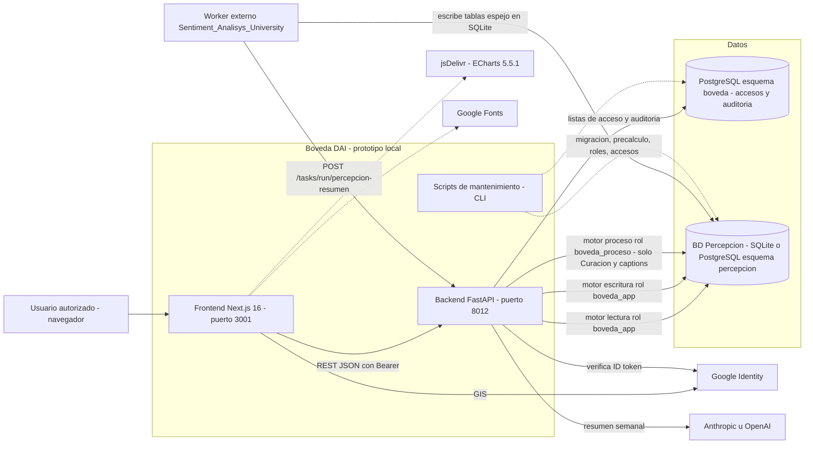
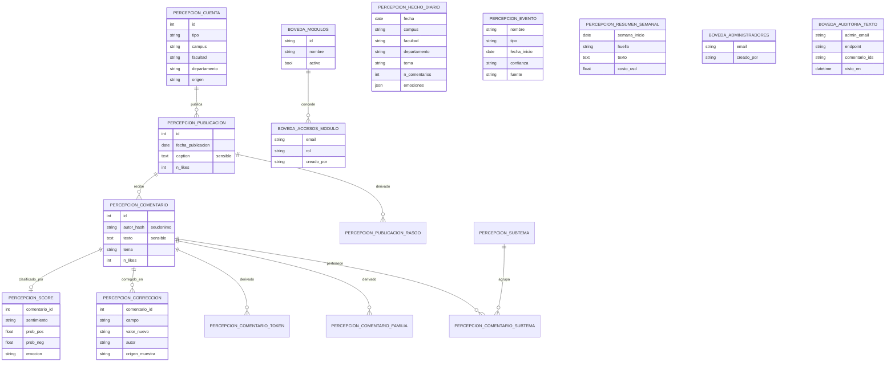

# 02 · Arquitectura técnica — Bóveda DAI

> Diagnóstico del 2026-10-22 sobre el commit `6879a9e`. Estados: **Confirmado**, **Inferido**, **Propuesto**, **No verificado**. Rutas relativas a la raíz del repositorio. Las versiones con `^` o rango son las declaradas, no las instaladas.

## 1. B.1 Tecnologías

### Frontend

| Componente | Versión | Evidencia | Estado |
|---|---|---|---|
| Next.js (App Router, build con `--webpack`) | `^16.1.6` | `frontend/package.json` | Confirmado |
| React / React DOM | `^19.1.0` | `frontend/package.json` | Confirmado |
| TypeScript (`strict`, alias `@/*`) | `^5.7.2` | `frontend/package.json`, `frontend/tsconfig.json` | Confirmado |
| Tailwind CSS (v3, configuración en TS) | `^3.4.16` | `frontend/tailwind.config.ts` | Confirmado |
| PostCSS / Autoprefixer | `^8.4.49` / `^10.4.20` | `frontend/postcss.config.js` | Confirmado |
| Apache ECharts (por CDN jsDelivr, con SRI sha384) | `5.5.1` exacta | `frontend/src/components/EChartsChart.tsx:10-13` | Confirmado |
| Tipografías Manrope y Space Grotesk (Google Fonts por `@import`, sin `next/font`) | — | `frontend/src/app/globals.css:1` | Confirmado |
| Google Identity Services (script `gsi/client`) | — | `frontend/src/components/LoginScreen.tsx` | Confirmado |
| Gestión de estado | React Context (`SessionProvider`) + estado local; sin Redux, Zustand ni React Query | `frontend/src/lib/SessionProvider.tsx` | Confirmado |
| Biblioteca de componentes / iconos | Ninguna | `frontend/package.json` | Confirmado |
| Pruebas y lint de frontend | Ninguno; solo `npm run typecheck` | `frontend/package.json` | Confirmado |

### Backend

| Componente | Versión | Evidencia | Estado |
|---|---|---|---|
| Python | 3.11+ (probado con 3.11) | `README.md:72`; `from datetime import UTC` en `backend/app/services/auth.py:26` | Confirmado |
| FastAPI / Starlette | `0.139.0` / `>=1.0.1,<1.4.0` (rango por un CVE declarado en comentario) | `backend/requirements.txt:1-2` | Confirmado |
| Uvicorn | `0.40.0` | `backend/requirements.txt` | Confirmado |
| Pydantic | `2.12.5` | `backend/requirements.txt` | Confirmado |
| SQLAlchemy (ORM) | `2.0.41` | `backend/requirements.txt` | Confirmado |
| psycopg (v3, binario) | `3.3.6` | `backend/requirements.txt:10` | Confirmado |
| google-auth / requests | `2.41.1` / `2.32.3` | `backend/requirements.txt` | Confirmado |
| anthropic (SDK) / httpx (para OpenAI) | `1.0.0` / `0.28.1` | `backend/requirements.txt` | Confirmado |
| python-dotenv | `1.2.1` | `backend/requirements.txt` | Confirmado |
| Pruebas | pytest `>=8,<9`; openpyxl y numpy solo para scripts y pruebas | `backend/requirements-dev.txt` | Confirmado |
| ML local (solo scripts, no la API) | torch `2.7.1` (CPU), sentence-transformers `6.2.0`, scikit-learn `1.9.1` | `backend/requirements-ml.txt:1-9` | Confirmado |

### Datos, infraestructura y proveedores

| Elemento | Detalle | Estado |
|---|---|---|
| Base de accesos | PostgreSQL, esquema `boveda` (`BOVEDA_DATABASE_URL`) | Confirmado (`backend/sql/001_boveda_access.sql`, `002_boveda_admin_audit.sql`) |
| Base de Percepción | SQLite local (por defecto `backend/percepcion.db`) o PostgreSQL, esquema `percepcion` | Confirmado (`backend/app/services/percepcion/db.py:35-123`) |
| Roles de base de datos | `boveda_app` (sin lectura de `texto` ni `caption`) y `boveda_proceso` (con lectura) | Confirmado (`backend/sql/003_percepcion_roles.sql`) |
| Autenticación | Google ID token + sesión propia HMAC-SHA256 | Confirmado |
| IA externa | Anthropic (por defecto `claude-haiku-4-5`) con *fallback* a OpenAI (`gpt-5.4-mini` por defecto) vía Responses API | Confirmado (`resumen_llm.py:80,117,693-701`; `config.py:94-96`) |
| IA local | `sentence-transformers/paraphrase-multilingual-MiniLM-L12-v2` + KMeans (subtemas) | Confirmado (`scripts/agrupar_subtemas_percepcion.py:68-76`) |
| Infraestructura de despliegue | **Ninguna en el repositorio.** Prototipo local (Confirmado por el responsable). Ejecución con `Boveda DAI.bat` y `.claude/launch.json` (backend `127.0.0.1:8012`, frontend `127.0.0.1:3001`) | Confirmado |
| Infraestructura histórica (Torre de Control) | Cloud Run, Cloud SQL PostgreSQL 17 y Secret Manager en GCP, región `southamerica-east1` | Confirmado solo como documentación histórica (`docs/PERCEPCION_CONTRATO_WORKER.md:29-53`). No aplica a la Bóveda |

## 2. B.2 Arquitectura actual

### Organización del repositorio

```
backend/
  app/
    main.py, config.py, database.py, schemas.py
    routers/   auth.py, percepcion.py (46 rutas), tasks.py
    services/  auth.py, costos.py (stub), accesos/ (puerto + adaptadores), percepcion/ (20 módulos)
    data/      percepcion_calendario_ucn.json
  sql/         001 accesos, 002 administradores y auditoría, 003 roles de Percepción
  tests/       37 archivos, unas 715 funciones de prueba
frontend/
  src/app/         layout, page (sesión), percepcion/page, globals.css (tokens), icon.svg
  src/components/  Bovedas*, LoginScreen, Recibidor, PaginaProtegida, Percepcion*.tsx, EChartsChart
  src/lib/         session, SessionProvider, roles, solicitud, paleta, percepcion (cliente API)
scripts/           19 scripts de operación, evaluación y mantenimiento
docs/              documentación histórica del módulo (heredada de la Torre)
```

Tamaño aproximado: unas 8.700 líneas en `backend/app` y unas 12.200 en `frontend/src`. Archivos más grandes: `repository.py` (2.861), `PercepcionPanel.tsx` (2.232) y `lib/percepcion.ts` (1.342). **Confirmado** (conteo `wc -l`).

### Capas

| Capa | Responsabilidad | Observación | Estado |
|---|---|---|---|
| Presentación | Next.js, todas las páginas `"use client"`; fetch con `Authorization: Bearer` | Sin SSR de datos: el navegador llama directo al backend | Confirmado |
| API | Routers FastAPI delgados con autorización por dependencias (`require_module`, `require_admin`) | Todos los endpoints son síncronos (`def`) | Confirmado |
| Dominio de accesos | `services/accesos/` con puerto (`Protocol`), adaptador PostgreSQL, adaptador en memoria y `DenyAll` | Arquitectura hexagonal bien aplicada, con un contrato de pruebas compartido (`backend/tests/contrato_accesos.py`) | Confirmado |
| Dominio de Percepción | `services/percepcion/*` reciben una `Session` de SQLAlchemy y consultan modelos ORM | Sin puertos: `repository.py` mezcla consultas, reglas y formato | Confirmado |
| Persistencia | Tres motores de Percepción (lectura, escritura y proceso) más el motor de accesos | La separación por privilegios es el punto más sólido | Confirmado |

### Diagrama de contexto y contenedores (C4 simplificado)

Elementos confirmados. Las líneas punteadas son dependencias opcionales o manuales.



### Comunicación y procesos

| Aspecto | Situación | Evidencia | Estado |
|---|---|---|---|
| Frontend ↔ backend | REST/JSON, `Authorization: Bearer`; CORS sin credenciales; URL del backend fijada en el build (`NEXT_PUBLIC_API_BASE_URL`) | `backend/app/main.py:33-39`; `frontend/src/lib/session.ts:5` | Confirmado |
| Backend ↔ bases | SQLAlchemy síncrono. SQLite con WAL y `query_only` en lectura; PostgreSQL con sesión `READ ONLY` en lectura y `search_path` por URL | `services/percepcion/db.py:39-123` | Confirmado |
| Procesos asíncronos | No hay colas, *workers* ni programador. El resumen se genera dentro de la petición o del disparador | `routers/tasks.py:42` | Confirmado |
| Caché | Solo el del resumen semanal (tabla con huella sha256). Los agregados se calculan en cada petición | `resumen_llm.py:595-624` | Confirmado |
| Efectos al importar | `db.py` ejecuta DDL idempotente (crear tablas, añadir columnas, deduplicar) al importarse, dentro de `try/except` silenciosos | `services/percepcion/db.py:130-248` | Confirmado |
| Arranque | `create_all` en el *lifespan*; validación de secretos en producción | `main.py:19-28`; `config.py:101-117` | Confirmado |

## 3. Modelo de datos conceptual

Las tablas espejo pertenecen al worker externo. La Bóveda no altera su esquema, **pero sí modifica sus datos** durante la curación (ver [05](05_HALLAZGOS_Y_PREGUNTAS.md)). **Confirmado** (`services/percepcion/models.py`, `backend/sql/003_percepcion_roles.sql:39-52`).



| Grupo | Tablas | Dueño | Estado |
|---|---|---|---|
| Espejo del worker | `percepcion_cuenta`, `percepcion_publicacion`, `percepcion_comentario`, `percepcion_score`, `percepcion_hecho_diario` | Worker externo (la Bóveda modifica `tema`, `score` y reconstruye `hecho_diario`) | Confirmado |
| Propias de la Bóveda | `percepcion_correccion`, `percepcion_tema_custom`, `percepcion_evento`, `percepcion_resumen_semanal` | Bóveda | Confirmado |
| Derivadas del texto (reconstruibles) | `percepcion_comentario_token`, `percepcion_comentario_familia`, `percepcion_publicacion_rasgo`, `percepcion_subtema`, `percepcion_comentario_subtema` | Scripts con rol de proceso | Confirmado |
| Accesos y auditoría | `boveda.modulos`, `boveda.accesos_modulo`, `boveda.administradores`, `boveda.auditoria_texto` | Bóveda | Confirmado |

**Fuentes de información:**

- Comentarios y captions de cuentas públicas de Instagram de la UCN, ingeridos por el worker (`scripts/_exportar_dataset_percepcion.py:302`, `PercepcionPanel.tsx:1317-1318`). **Confirmado**.
- Calendario académico UCN 2022–2026 entregado por la DAI (`percepcion_calendario_ucn.json`, `_meta.fuente`). **Confirmado**.
- Frecuencia de actualización: manual, tras cada ingesta. **Inferido**. No hay programador.

**Volumen** (cifras de documentación histórica): unos 8.200 comentarios de 80 cuentas, 2022–2026 (`docs/HANDOFF_MODULO_PERCEPCION.md:58-64`). **No verificado** sobre la base actual.

**Datos personales o sensibles (solo categorías):**

- Texto libre de comentarios de la comunidad.
- Captions de publicaciones.
- Identificadores y nombres de cuentas de redes sociales, incluidas organizaciones estudiantiles.
- Seudónimo irreversible del autor (`autor_hash`).
- Correos de administradores, revisores y operadores (`autor`, `renombrado_por`, `creado_por`, `admin_email`).
- Justificaciones libres de curación.

**Confirmado** (`models.py`).

## 4. C.2 Inventario de API

**Totales: 53 handlers** = 5 de `/auth`, 46 de `/percepcion`, 1 de `/tasks` (montado además en `/ai-tasks`, oculto en el esquema) y `/health`. **Confirmado** (`routers/*.py`, `main.py:41-49`).

- **Sin versionado.** No hay `/v1`.
- **Sin personalización de OpenAPI.** `/docs`, `/redoc` y `/openapi.json` quedan expuestos sin autenticación.
- **No existe un archivo OpenAPI versionado** en el repositorio.

**Confirmado**.

**Parámetros comunes de `/percepcion` (objeto `Filtro`, `routers/percepcion.py:112-149`):**

- `dias` (1–36500, por defecto 30).
- `sede`, `facultad`, `departamento`, `tema`.
- `peso_likes` (0–1).
- `vida_media` (0–3650).
- `fecha_desde`, `fecha_hasta`.

**Autorización por método:** GET exige rol `lector` o superior en el módulo; POST, PUT y DELETE exigen `equipo` o administrador (`routers/percepcion.py:69-103`). `/curacion/*` exige además administrador.

### `/auth`

| Método y ruta | Finalidad | Entrada → salida | Autenticación | Efectos | Reutilización institucional |
|---|---|---|---|---|---|
| GET `/auth/config` | Configuración pública del login | → `AuthConfigResponse` | Ninguna | — | Baja |
| GET `/auth/session-user` | Usuario de la sesión revalidado | → `AuthUser` | Bearer + cuenta permitida | Lectura de accesos | Media (patrón) |
| GET `/auth/me` | Usuario con `is_admin` y `modulos` | → `AuthUser` | Bearer | Lectura de accesos | Alta como patrón de "mis aplicaciones" |
| GET `/auth/dev-login` | Sesión sin OAuth | `email`, `name` → `LoginResponse` | Solo con `APP_ENV=dev` (404 en otro caso) | Emite sesión | Ninguna |
| POST `/auth/google/verify` | Canje de ID token por sesión | `{credential}` → `LoginResponse` | Ninguna | Emite sesión o 403 | Media |

Evidencia: `backend/app/routers/auth.py:22-77`.

### `/percepcion`: lectura (28 GET fuera de Curación)

| Ruta | Finalidad | Respuesta |
|---|---|---|
| `/filtros` | Opciones de filtro y rango de fechas | `FiltrosResponse` |
| `/resumen` | Índice actual, promedio, tendencia, distribución | `ResumenPercepcion` |
| `/concentracion` | Gini de prevalencia por tema entre unidades | `ConcentracionResponse` |
| `/postura` | Favorable / neutral / adverso | `PosturaInstitucionalResponse` |
| `/evolucion` | Serie diaria con marca de anomalía | `SerieEvolucion` |
| `/por-tema`, `/por-unidad` | Comparaciones | `ComparacionTemas`, `ComparacionUnidades` |
| `/emociones` | Distribución de emociones | `EmocionesResponse` |
| `/nube` | Nube de palabras desde tablas derivadas | `NubeResponse` |
| `/sintesis` | Resumen ejecutivo determinista | `SintesisResponse` |
| `/publicaciones-dominantes` | Publicaciones que concentran conversación | `PublicacionesDominantesResponse` |
| `/destacados` | Palabras que más pesan, emoción en alza | `DestacadosResponse` |
| `/terminos` | Términos bajo vigilancia (léxico de conflicto) | `TerminosResponse` |
| `/eventos`, `/eventos/tipos`, `/eventos/todos` | Marcas de contexto y catálogo | `EventosResponse`, `TiposEventoResponse` |
| `/anomalias` | Alertas quincenales | `AnomaliasResponse` |
| `/comentarios` | Fichas de comentarios **sin texto** | `ComentariosResponse` |
| `/subtemas` | Subtemas anonimizados | `SubtemasResponse` |
| `/resumen-semanal` | Resumen narrativo LLM de una semana (**efecto lateral**: puede llamar al LLM y escribir caché aunque lo pida un lector; `forzar=true` exige `equipo`) | `ResumenSemanalResponse` |
| `/resumen-semanal/semanas` | Semanas navegables | `SemanasDisponiblesResponse` |
| `/conflicto` | Volumen adverso y consistencia del signo | `ConflictoResponse` |
| `/comunicacion`, `/ensayo` | Efecto de rasgos de publicación; probabilidad de conversación | `ComunicacionResponse`, `EnsayoResponse` |
| `/shock` | Caída y recuperación tras paros | `ShockResponse` |
| `/baselines` | Backtesting de líneas base | `BaselinesResponse` |
| `/volatilidad` | Volatilidad estructural por unidad | `VolatilidadResponse` |
| `/impacto-palabras` | Impacto leave-one-out de palabras | `ImpactoPalabrasResponse` |

Evidencia: `routers/percepcion.py:152-800`.

**Reutilización institucional:** alta para `/resumen`, `/evolucion`, `/anomalias`, `/por-unidad` y `/eventos` como agregados anonimizados. Hoy solo admiten sesión de usuario. **Inferido**.

### `/percepcion`: escritura de equipo

| Ruta | Efecto | Autor registrado |
|---|---|---|
| POST `/eventos` | Inserta evento | No |
| PUT `/eventos/{evento_id}` | Actualiza evento | No |
| DELETE `/eventos/{evento_id}` | Borra evento | No |

Evidencia: `routers/percepcion.py:336-364`; `models.py:365-383`. **Confirmado**.

### `/percepcion/curacion/*`: solo administración (15 rutas)

| Ruta | Efecto | Texto crudo | Auditoría |
|---|---|---|---|
| GET `/curacion/temas` | — | No | — |
| POST `/curacion/tema` | Inserta tema personalizado | No | No |
| GET `/curacion/publicaciones` | — | Captions (160 caracteres) | **No** |
| GET `/curacion/comentarios` | — | **Sí** | Sí |
| POST `/curacion/publicacion/{pub_id}`, `/curacion/comentario/{com_id}` | Asigna tema y reagrega | No | No deja corrección |
| GET `/curacion/scoring/opciones` | — | No | — |
| GET `/curacion/scoring` | — | **Sí** | Sí |
| POST `/curacion/sentimiento/{id}`, `/tema/{id}`, `/postura/{id}`, `/emocion/{id}` | Inserta corrección, actualiza score y reagrega | No | Corrección con autor |
| PUT `/curacion/subtemas/{subtema_id}` | Renombra subtema | No | `renombrado_por` |
| GET `/curacion/calidad` | — | No | — |
| GET `/curacion/correcciones` | — | Justificaciones libres | No |

Evidencia: `routers/percepcion.py:599-828`. **Confirmado**.

### Otras

| Ruta | Autenticación | Efectos | Nota |
|---|---|---|---|
| POST `/tasks/run/percepcion-resumen` (y `/ai-tasks/...`) | `X-Tasks-Token` (403 si el token configurado está vacío) | Genera el resumen y escribe la caché | Responde **siempre 200**, con `reason` truncado a 300 caracteres ante un error (`routers/tasks.py:55-56`) |
| GET `/health` | Ninguna | — | Devuelve el nombre de la aplicación y `APP_ENV`; no comprueba dependencias (`main.py:47-49`) |

## 5. B.3 Autenticación y autorización

| Aspecto | Situación | Evidencia | Estado |
|---|---|---|---|
| Inicio de sesión | Google Identity Services. El backend verifica el ID token con `verify_oauth2_token`, la audiencia `GOOGLE_CLIENT_ID` y `email_verified` | `services/auth.py:243-276` | Confirmado |
| Restricción de dominio | **No hay.** `hd` se guarda solo como dato informativo. La barrera es la lista de accesos | `services/auth.py:271` | Confirmado |
| Sesión | Token propio, no JWT: `base64url(JSON) . base64url(HMAC-SHA256)`, con `exp` y `nonce`; TTL de 8 horas por defecto | `services/auth.py:60-63,129-174` | Confirmado |
| Transporte y almacenamiento | Cabecera `Authorization: Bearer`; el token y el objeto usuario se guardan en `localStorage`; sin cookies | `services/auth.py:180-189`; `frontend/src/lib/session.ts:76-77` | Confirmado |
| Revocación | Al quitar una fila de acceso, la siguiente petición se rechaza. No hay revocación de tokens ni cierre de sesión en el servidor | `services/auth.py:76-114` | Confirmado |
| Roles | `lector` y `equipo` por módulo; administrador global. Precedencia: admin > equipo > lector | `backend/app/schemas.py:9-17`; `services/auth.py:73,101-103` | Confirmado |
| Control por recurso | Por módulo y por método HTTP; Curación solo para administración. No hay control por fila ni por unidad (todo lector ve todas las sedes) | `routers/percepcion.py:66-103` | Confirmado |
| Fail-closed | URL vacía o error de base → `DenyAll`; módulo inactivo no da acceso ni a administradores; arranque bloqueado sin secretos en producción | `services/accesos/__init__.py:60-124`; `postgres.py:38-48,92-126`; `config.py:101-117` | Confirmado |
| Privilegios en la base | Permiso por columna: `boveda_app` no puede leer `texto` ni `caption`; las tablas nuevas quedan inaccesibles hasta conceder permiso | `backend/sql/003_percepcion_roles.sql:34-52,92-146` | Confirmado |
| Auditoría | `boveda.auditoria_texto` guarda `admin_email`, `modulo_id`, `endpoint` (sin query string), `comentario_ids` y `visto_en`. Si no se puede registrar, la respuesta es 503 | `sql/002:18-28`; `routers/percepcion.py:81-96` | Confirmado |
| Brechas de auditoría | No se guardan IP ni parámetros. Las captions de `/curacion/publicaciones` no se auditan. Eventos y asignación de temas no guardan autor. La inmutabilidad es "por convención" (sin trigger ni REVOKE) | `sql/002:16-17` | Confirmado |
| Límite reconocido | El mismo proceso guarda las dos credenciales de base de datos; protege contra la exposición accidental, no contra un servidor comprometido | `README.md:204-208` | Confirmado |

### Restricciones para un SSO institucional

1. **Identidad separada de autorización.** La sesión es propia de la aplicación y el rol no viaja en el token. Un SSO podría reemplazar la verificación de Google sin tocar el modelo de autorización por módulo. **Inferido**.
2. **Token HMAC con secreto propio.** No es interoperable con otras aplicaciones: compartir sesión requeriría un emisor común (OIDC) o un secreto compartido. Lo segundo no se recomienda. **Inferido**.
3. **Token legible por scripts.** `localStorage` sin CSP es incompatible con una sesión SSO de alto privilegio. Habría que migrar a cookies `HttpOnly` o a un patrón BFF. **Propuesto**.
4. **Linaje con la Torre de Control.** `services/auth.py:3` y `frontend/src/lib/session.ts:2` declaran estar modelados sobre la Torre, por lo que es probable que compartan el mismo esquema de sesión. **Confirmado** el linaje; la compatibilidad está **No verificada**.

## 6. B.4 Calidad y operación

| Aspecto | Situación | Evidencia | Estado |
|---|---|---|---|
| Pruebas backend | 37 archivos y unas 715 funciones `def test_`. Cubren compuertas de acceso, fail-closed, anonimización de la API, privilegios (análisis AST), metodología, migración, paridad SQLite/PostgreSQL y subtemas | `backend/tests/` | Confirmado (conteo estático, no ejecutado) |
| Pruebas que se omiten | Las de PostgreSQL real sin `BOVEDA_TEST_DATABASE_URL` o `PERCEPCION_TEST_DATABASE_URL`; las de subtemas sin scikit-learn | `backend/tests/test_accesos_postgres.py:20`; `backend/tests/pg_percepcion.py:21` | Confirmado |
| Aislamiento de la suite | `conftest.py` fuerza una base temporal y vacía las claves de LLM | `backend/tests/conftest.py:24-37` | Confirmado |
| Cobertura medida | Sin herramienta de cobertura configurada | — | No evaluable |
| Pruebas frontend | Ninguna | `frontend/package.json` | Confirmado |
| CI/CD | **Ausente** (sin `.github/`, Cloud Build ni equivalentes) | `git ls-files` | Confirmado |
| Lint y formato | **Ausente** (sin ruff, mypy, eslint ni prettier) | — | Confirmado |
| Contenedores | **Ausente** (sin Dockerfile ni compose) | — | Confirmado |
| Observabilidad | `logging` estándar (logger `boveda`) sin configuración central; sin métricas, trazas ni error tracking; `/health` estático | `main.py:15,47-49` | Confirmado |
| Gestión de errores | `HTTPException` por endpoint (400, 404, 409, 422, 503), sin manejador global. Varios `except Exception: pass` en el arranque y en cálculos de apoyo. El frontend muestra el cuerpo crudo del error en la mayoría de los bloques | `services/percepcion/db.py:73-74,165-248`; `frontend/src/lib/percepcion.ts` | Confirmado |
| Higiene de logs | Las capas de acceso registran solo la clase de la excepción, para no filtrar la URL de la base | `services/accesos/postgres.py:232-233` | Confirmado |
| Entornos | `APP_ENV=dev` o producción (cualquier otro valor). Solo existe ejecución local | `config.py:36` | Confirmado |
| Documentación técnica | `README.md` completo y vigente. `docs/` es histórica y describe la Torre. `backend/.env.example` estaría desactualizado (H-18, no verificado en la revisión final). Los subtemas no están documentados | `README.md:266` | Confirmado |
| Seguridad del frontend | Cabeceras `nosniff`, `X-Frame-Options: DENY`, `Referrer-Policy` y `Permissions-Policy`; **sin CSP**; `robots: noindex` | `frontend/next.config.ts`; `frontend/src/app/layout.tsx` | Confirmado |

### Variables de entorno (solo nombres)

| Ámbito | Variables |
|---|---|
| Backend | `APP_NAME`, `APP_ENV`, `APP_SESSION_SECRET`, `APP_SESSION_TTL_SECONDS`, `BACKEND_CORS_ORIGINS`, `GOOGLE_CLIENT_ID`, `GOOGLE_OAUTH_ENABLED`, `BOVEDA_DATABASE_URL`, `DEV_DEFAULT_USER_EMAIL`, `DEV_DEFAULT_USER_NAME`, `TASKS_TRIGGER_TOKEN`, `OPERATIONAL_DATABASE_URL`, `PERCEPCION_DATABASE_URL`, `PERCEPCION_PROCESO_DATABASE_URL`, `PERCEPCION_RESUMEN_MODELO`, `PERCEPCION_UNIDAD_DETECCION_SEMANAS`, `PERCEPCION_CREDITO_NO_ATRIBUIBLE`, `PERCEPCION_NEU_FEDERACION_ADVERSO`, `ANTHROPIC_API_KEY`, `OPENAI_API_KEY`, `OPENAI_CHAT_MODEL`, `LLM_PRECIOS_JSON` (`backend/app/config.py:34-98`) |
| Solo scripts | `PERCEPCION_ADMIN_DATABASE_URL`, `PERCEPCION_APP_DB_PASSWORD`, `PERCEPCION_PROCESO_DB_PASSWORD`, `PERCEPCION_TEST_DATABASE_URL`, `BOVEDA_TEST_DATABASE_URL`, `PERCEPCION_SUBTEMAS_MODELO`, `PERCEPCION_SUBTEMAS_VETADOS`, `PERCEPCION_DB_VERIFICACION`, `ANTHROPIC_JUDGE_MODEL` |
| Frontend | `NEXT_PUBLIC_API_BASE_URL`, `NEXT_PUBLIC_PERCEPCION_FEEDBACK_URL` |

### Riesgos de mantenimiento

1. **Componentes monolíticos.** `repository.py` (2.861 líneas) y `PercepcionPanel.tsx` (2.232) concentran demasiadas responsabilidades. **Confirmado**.
2. **Lógica de agregación duplicada del worker** en `curacion.reagregar()`, con riesgo de deriva. Ya ocurrió una vez: 894 filas perdieron `origen` (`docs/notas/percepcion-pestanas-y-deriva-worker.md`). **Confirmado**.
3. **DDL al importar y excepciones silenciadas**, que dificultan diagnosticar fallos de esquema. **Confirmado**.
4. **Único mantenedor, sin CI.** Las pruebas de PostgreSQL no tienen evidencia de ejecución regular. **Confirmado** / **Inferido**.
5. **Herencia de la Torre de Control** en nombres (`--portal-*`, tema ECharts `"torre"`), docstrings y rutas (`/ai-tasks`). **Confirmado**.
